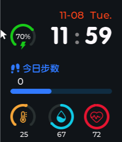

# 第 1 课：主页静态布局

> 状态：**已实现**。代码由我写，本课任务是读懂它，然后完成文末的小练习。



- 你的代码：[ui_HomePage.c](study_workstation/ovwatch_learn/User/GUI_App/Screens/Src/ui_HomePage.c)
- 接口声明：[ui_HomePage.h](study_workstation/ovwatch_learn/User/GUI_App/Screens/Inc/ui_HomePage.h)
- 参考实现：[参考 ui_HomePage.c](Software/OV_Watch/User/GUI_App/Screens/Src/ui_HomePage.c)
- 屏幕：240 × 280

---

## 一、这个文件的结构

打开 [ui_HomePage.c](study_workstation/ovwatch_learn/User/GUI_App/Screens/Src/ui_HomePage.c)，从上到下分四块：

| 行 | 内容 |
|----|------|
| 13-51 | 控件指针：每个控件一个全局变量 |
| 53-77 | 页面数据：时间、日期、电量等初始值 |
| 79-81 | `ui_HomePage_screen_init()`：真正的布局代码 |
| 320-322 | `ui_HomePage_screen_deinit()`：页面销毁时的清理 |

为什么控件指针要放全局？因为后面的动态刷新（1.2 课）要在别处
（定时器回调）里修改这些 label 的文字，必须能拿到它们。

---

## 二、逐段讲解

### 1. 创建屏幕（81-87 行）

```c
ui_HomePage = lv_obj_create(NULL);
lv_obj_clear_flag(ui_HomePage, LV_OBJ_FLAG_SCROLLABLE);
```

`lv_obj_create(NULL)` 的 `NULL` 表示"没有父对象"，于是创建出来的就是一块**屏幕**。
屏幕默认可以滚动，手表界面不需要，所以清掉 `SCROLLABLE` 标志。

### 2. 时间（89-116 行）

```c
ui_TimeHourLabel = lv_label_create(ui_HomePage);
lv_obj_set_x(ui_TimeHourLabel, -105);
lv_obj_set_y(ui_TimeHourLabel, -70);
lv_obj_set_align(ui_TimeHourLabel, LV_ALIGN_RIGHT_MID);
```

这里的关键是**对齐 + 偏移**：

- `LV_ALIGN_RIGHT_MID` 把 label 锚定到屏幕的"右侧中点"
- 此时 `x = -105` 表示从右边往左退 105 像素，`y = -70` 表示从垂直中线往上 70 像素

所以三个 label 都用右中对齐，只要调整 x 就能横向排开：

```
右边缘
  ← 20  分钟
  ← 82  冒号
  ← 105 小时
```

`"%2d"` 和 `"%02d"` 的区别：小时用空格补齐（`"11"` 前面有一个空格），
分钟用零补齐（`"05"` 而不是 `" 5"`），这样数字切换时不会左右跳动。

字体 `ui_font_Cuyuan48` 是参考工程里已经生成好的字体文件，
Makefile 直接从 `user_test/GUI_App/Fonts/` 编译进来，所以这里可以直接用。

### 3. 电量圆弧（118-152 行）

圆弧（arc）由三个部分组成，这是 LVGL 里很容易搞混的地方：

| 部分 | 选择器 | 作用 |
|------|--------|------|
| 背景轨道 | `LV_PART_MAIN` | 灰色的整圈 |
| 进度指示 | `LV_PART_INDICATOR` | 绿色的一段，随数值变化 |
| 圆点 | `LV_PART_KNOB` | 指示条末端的小圆点 |

```c
lv_obj_clear_flag(ui_BatArc, LV_OBJ_FLAG_CLICKABLE);
```

arc 默认是**可交互**的：鼠标拖动会改变数值。电量只是显示，所以去掉点击能力，
否则用户一拖电量就变了。

`lv_obj_set_style_pad_all(..., 0, LV_PART_KNOB)` 是把圆点的内边距清零，
否则圆点会偏出去，和圆环对不齐。

### 4. 日期（154-173 行）

和时间的写法完全一样，只是字体换成 `lv_font_montserrat_20`、颜色换成红色。
星期用了一个字符串数组：

```c
const char *ui_Days[7] = {"Mon.", "Tue.", ...};
lv_label_set_text(ui_DayLabel, ui_Days[ui_DataWeekdayValue - 1]);
```

`ui_DataWeekdayValue = 2` 对应 `ui_Days[1]`，也就是 `"Tue."`。
数组下标从 0 开始，所以减 1。

### 5. 步数（175-210 行）

进度条 `lv_bar` 同样有 `MAIN`（底槽）和 `INDICATOR`（已完成的蓝色部分）。
宽度固定 200，高度 10，放在屏幕中心偏下。

注意数字 label 和进度条是**两个独立对象**，不是进度条的一部分。
参考里进度条固定 40%，数字是 0，两者并不联动——这也是原项目的现状。

### 6. 温度 / 湿度 / 心率（212-315 行）

三个圆弧的写法和电量一样，只有三个区别：

- 温度设置了范围 `-20 ~ 60`，因为温度可以是负数
- 湿度和心率的圆弧起点/终点改成 `lv_arc_set_bg_angles(arc, 270, 620)`，
  这样画出来是一个带 10° 缺口的接近整圆
- 颜色不同

心率这里 `lv_arc_set_value(ui_HRArc, 100)` 是参考实现的原样——静态初始化时
先画满一圈，后续动态刷新时再改成真实心率。我们保留了这个行为。

---

## 三、与参考实现的差异

为了适配 PC 仿真和后续课程，做了几处等价简化：

| 参考写法 | 我们的写法 | 原因 |
|----------|------------|------|
| `lv_obj_set_width` + `lv_obj_set_height` | `lv_obj_set_size` | 一行搞定，等价 |
| 四次 `lv_obj_set_style_pad_*` | `lv_obj_set_style_pad_all` | 等价 |
| 图标字符直接写在字符串里 | `#define ICON_BAT "\xEE\x9A\x8F"` | 私用区字符在编辑器里看不见，用十六进制更明确 |
| `HWInterface.HR_meter.HrRate` | 固定 `72` | 1.3 课接入硬件抽象层后再替换 |
| `deinit` 里 `lv_timer_del` | 已在 1.2 课补上 | 创建定时器后才需要 |
| — | 编译参考工程的字体文件 | 完成原计划的单元 0.3 |

---

## 四、动手练习

先编译运行看效果：

```powershell
cd D:\LearningRecourse\FriChicken\OV-Watch\study_workstation\ovwatch_learn
mingw32-make -j4
.\bin\ovwatch_learn.exe
```

然后依次做下面几件事，每做一次就重新编译看变化：

1. **改数据**：把 `ui_TimeHourValue` 改成 8、`ui_TimeMinuteValue` 改成 5，
   观察小时和分钟的对齐是否变化。
2. **改颜色**：把电量圆弧的绿色 `0x19C819` 改成红色 `0xE11432`。
3. **改布局**：把日期向下移动 20 像素（提示：`lv_obj_set_y` 的 `-110`）。
4. **换字体**：把小时的字体从 `ui_font_Cuyuan48` 换成 `lv_font_montserrat_48`，
   对比字形差异。
5. **加控件**：在屏幕左上角加一个 `"HELLO"` 的 label，字体 20、白色。

做完把你的修改发给我，我看看有没有理解偏差。

---

## 五、下一步

**单元 1.2：让主页动起来。** 已完成，见 [第 2 课：动态刷新](02_动态刷新.md)。
