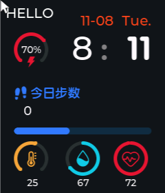
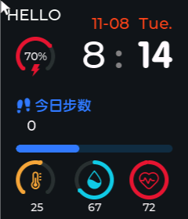

# 第 2 课：让主页动起来（lv_timer）

> 状态：**已实现**。本课解释 `lv_timer` 是怎么把「一块静态画面」变成「会走的手表」的。

## 效果

同一块屏幕，间隔 3 秒截两张图：

| 第 0 秒 | 第 3 秒 |
|---------|---------|
|  |  |

分钟从 `8:11` 变到 `8:14`。之所以 3 秒走 3 分钟，是因为我们把假时钟**加速了 60 倍**
（`FAKE_CLOCK_SPEED = 60`），正常速度下肉眼根本看不出变化，不利于调试。

- 你的代码：[ui_HomePage.c](study_workstation/ovwatch_learn/User/GUI_App/Screens/Src/ui_HomePage.c)
- 参考实现：[参考 ui_HomePage.c](Software/OV_Watch/User/GUI_App/Screens/Src/ui_HomePage.c)（81 行、707 行、747 行）

---

## 一、为什么需要定时器

LVGL 是**单线程**的。整个程序里只有一个循环在干活：

```c
while (1) {
    lv_timer_handler();   /* 处理输入、跑定时器、刷新脏区域 */
    usleep(5000);
}
```

这个循环在 [main.c](study_workstation/ovwatch_learn/main.c) 里。它既负责把画面画到屏幕上，
也负责调用所有到点的定时器。

所以想在屏幕上「过一秒改一次文字」，有两种错误做法和一个正确做法：

| 做法 | 问题 |
|------|------|
| 在 `init()` 里 `while(1){ 改文字; sleep(1); }` | 死循环，`init()` 永远不返回，界面出不来 |
| 自己开一个线程改文字 | LVGL 不是线程安全的，会让渲染和修改打架，随机崩溃 |
| **`lv_timer_create()` 注册一个回调** | ✅ LVGL 在合适的时候替你调用，天然在同一个线程 |

**记住这条：所有操作 LVGL 控件的代码，都必须跑在调用 `lv_timer_handler()` 的那个线程里。**

---

## 二、定时器的三个动作

### 1. 创建（[ui_HomePage.c:358](study_workstation/ovwatch_learn/User/GUI_App/Screens/Src/ui_HomePage.c#L358)）

```c
ui_HomePageTimer = lv_timer_create(HomePage_timer_cb, 1000, NULL);
```

三个参数：

| 参数 | 值 | 含义 |
|------|-----|------|
| 回调函数 | `HomePage_timer_cb` | 到点后调用谁 |
| 周期 | `1000` | 毫秒，即每秒一次 |
| user_data | `NULL` | 传给回调的自定义数据，参考工程这里也没用 |

返回的 `lv_timer_t *` 必须存起来，因为**删除时需要它**。存在文件级 `static` 变量里：

```c
static lv_timer_t *ui_HomePageTimer = NULL;
```

用 `static` 是因为它只属于这个文件，不放进头文件，别的文件看不见也不需要看见。

### 2. 回调（[ui_HomePage.c:92-113](study_workstation/ovwatch_learn/User/GUI_App/Screens/Src/ui_HomePage.c#L92-L113)）

```c
static void HomePage_timer_cb(lv_timer_t *timer)
{
    char buf[12];
    (void)timer;

    fake_second += FAKE_CLOCK_SPEED;
    if (fake_second < 60) {
        return;                 /* 这一秒还没凑够一分钟 */
    }
    fake_second -= 60;

    ui_TimeMinuteValue++;
    if (ui_TimeMinuteValue >= 60) {
        ui_TimeMinuteValue = 0;
        ui_TimeHourValue = (ui_TimeHourValue + 1) % 24;
        sprintf(buf, "%2d", ui_TimeHourValue);
        lv_label_set_text(ui_TimeHourLabel, buf);
    }

    sprintf(buf, "%02d", ui_TimeMinuteValue);
    lv_label_set_text(ui_TimeMinuteLabel, buf);
}
```

几个细节值得注意：

**`fake_second += FAKE_CLOCK_SPEED` 而不是 `fake_second++`**

定时器周期是 1000 ms，回调每秒被调一次。如果每次加 1，一分钟要走 60 秒，
你盯着屏幕一分钟才能看到分钟跳一下。改成加 60，就是每 1 秒跳 1 分钟。
`FAKE_CLOCK_SPEED = 1` 即真实速度。

**为什么要 `if (fake_second < 60) return;` 和 `fake_second -= 60;`**

将来把 `FAKE_CLOCK_SPEED` 改成 7、13 这种不能整除 60 的数，累加值就会跨过 60
而不是正好等于 60。用 `if` + `-=` 而不是 `if (fake_second == 60)` + `= 0`，
才能保证不管速度是多少，多出来的零头都会留到下次。

**为什么小时进位用 `% 24`，分钟归零用 `= 0`**

分钟加 1 最多到 60，`-0` 和 `% 60` 等价；小时是 `8 + 1`，必须取模才能在 23 点后回到 0 点。

**为什么 `sprintf` 用 `%2d` 和 `%02d`**

和第 1 课一样——小时用空格补齐，分钟用零补齐。

**`(void)timer;` 是干什么的**

回调签名要求有 `lv_timer_t *timer` 参数，但我们这里没用到。编译器会警告「未使用的参数」，
`(void)timer;` 是告诉它「我知道，是故意不用的」。

> 回调里**绝对不要**写 `osDelay` / `sleep`。参考实现在 88 行有一段被注释掉的代码，
> 想在回调里延时 500 ms 让冒号闪烁，结果会卡住整个界面刷新，作者自己注释掉了。
> 需要「等一会儿再做」时，用计时变量（像 `fake_second` 这样），不要阻塞。

### 3. 删除（[ui_HomePage.c:366-372](study_workstation/ovwatch_learn/User/GUI_App/Screens/Src/ui_HomePage.c#L366-L372)）

```c
void ui_HomePage_screen_deinit(void)
{
    if (ui_HomePageTimer != NULL) {
        lv_timer_del(ui_HomePageTimer);
        ui_HomePageTimer = NULL;
    }
}
```

这一步**不能省**。想象一下：用户从主页切到菜单页，主页被销毁，`ui_TimeMinuteLabel`
指向的内存被释放，但定时器还在每秒触发一次。下一次回调 `lv_label_set_text` 写进一块
已经释放的内存——轻则显示错乱，重则崩溃。这种 bug 很难查，因为崩溃点离出错点很远。

删除后把指针置 `NULL` 也是必要的：万一 `deinit` 被调用两次，第二次 `lv_timer_del(NULL)`
会崩；有了 `NULL` 判断，第二次直接安全跳过。

> 屏幕对象本身（`ui_HomePage`）不用在这里 delete。参考工程用
> `lv_scr_load_anim(..., LV_SCR_LOAD_ANIM_NONE, 0, 0, true)` 切页，最后一个 `true`
> 表示「旧屏幕自动删除」。这条要到 2.1 课做 PageManager 时才用得上。

---

## 三、和参考实现的差异

参考实现的定时器回调（[参考 ui_HomePage.c:81](Software/OV_Watch/User/GUI_App/Screens/Src/ui_HomePage.c#L81)）
长得不一样，因为我们还没有硬件抽象层。

| 参考写法 | 我们的写法 | 原因 |
|----------|------------|------|
| `lv_timer_create(..., 500, NULL)` | `1000` | 参考每 500 ms 查一次 RTC；我们的假时钟 1 秒走一格 |
| `HWInterface.RealTimeClock.GetTimeDate(&DateTime)` | `fake_second += FAKE_CLOCK_SPEED` | 1.3 课接入 `HWDataAccess` 后再换 |
| `if (Page_Get_NowPage()->page_obj == &ui_HomePage)` 包住整个回调 | 没有 | 目前只有主页一个页面；2.1 课做多页面时必须加回来 |
| `if (ui_TimeMinuteValue != DateTime.Minutes)` 先比较再写 | 直接写 | 见下 |

### 「先比较再写」的写法

参考实现里几乎每个字段都是这个模式：

```c
if (ui_TimeMinuteValue != DateTime.Minutes) {
    ui_TimeMinuteValue = DateTime.Minutes;
    sprintf(value_strbuf, "%02d", ui_TimeMinuteValue);
    lv_label_set_text(ui_TimeMinuteLabel, value_strbuf);
}
```

值没变就什么都不做。原因是 `lv_label_set_text` 即使写同样的字符串，LVGL 也会把
这个 label 标成「脏」，下一帧重新排版、重绘。主页有六七个动态字段，每 500 ms
全部重写一遍是白白浪费 CPU。实机上每省一点功耗都关系到续航。

我们的假时钟每个字段都是「真的变了才写」，所以暂时不需要这个判断。但等 1.3 换成
真实数据（比如温度常常几秒不变），就要照参考的写法加回来。

### 参考里还更新了什么

参考回调里除了时间，还更新了日期、电量、步数、温度、湿度——全部来自
`HWInterface.*`。它**没有**更新心率，心率是单独的心率页面在测。我们照这个分工来。

---

## 四、定时器在野外的几种用法

`lv_timer_create` 不只是做时钟，LVGL 内部到处都在用它。你已经见过的：

| 用途 | 周期 | 说明 |
|------|------|------|
| 主页时间刷新 | 1000 ms | 本课 |
| 参考的 HomePage 轮询 | 500 ms | 同一件事，频率不同 |
| `lv_anim` 动画 | 约 16 ms | 动画每一帧由 LVGL 内部的定时器驱动 |
| 长按/滚动惯性 | 不等 | LVGL 内部的输入处理定时器 |

后面还会遇到：

- **一次性定时器**：`lv_timer_set_repeat_count(timer, 1)`，只跑一次就自动停。
  适合「3 秒后自动返回主页」这类需求（倒计时页会用到）。
- **暂停定时器**：`lv_timer_pause(timer)` / `lv_timer_resume(timer)`。
  熄屏时停掉刷新能省电（阶段 6 会用到）。
- **改周期**：`lv_timer_set_period(timer, ms)`。秒表和倒计时页要动态调整频率。

---

## 五、动手练习

先确认程序在跑：现在窗口里分钟应该每秒钟跳一格。

1. **改成真实速度**：把 `FAKE_CLOCK_SPEED` 改成 `1`，重新编译运行。现在一分钟才跳一次。
   把 `1000` 也改成 `100`，观察分钟是不是仍然一分钟跳一次（思考：为什么不变？）。
2. **让冒号闪烁**：在回调里加一个 `static bool colon_on = true;`，每次回调翻转它，
   然后用 `lv_obj_add_flag/lv_obj_clear_flag(ui_TimeColonLabel, LV_OBJ_FLAG_HIDDEN)`
   隐藏或显示冒号。注意**不要**用 `lv_label_set_text` 改冒号内容。
3. **跨天更新日期**：小时从 23 进位到 0 时，把 `ui_DateDayValue` 加 1 并刷新
   `ui_DateLabel`（`sprintf(buf, "%2d-%02d", 月份, 日)`）。先不管月末怎么办——
   31 天以后会变成 32 号，这个坑我们在 3.2 课用真实日期时再补。

做完把代码发我，或者直接说「做完了」，我们进下一课。

---

## 六、下一步

**单元 1.3：硬件抽象层 `HWDataAccess`** —— 已完成，见 [第 3 课：硬件抽象层](03_硬件抽象层.md)。
