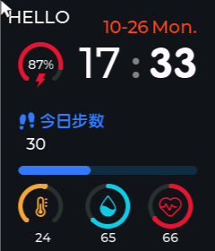

# 第 3 课：硬件抽象层 HWDataAccess

> 状态：**已实现**。这一课的重点不是代码多少，而是**为什么要多绕一层**。

## 效果



截图那一刻电脑时间 `17:33`，表上也是 `17:33`；日期 `10-26 Mon.` 也和系统一致。
步数 30、温度 24、湿度 65、心率 66 全是仿真出来的动态数据——**没有一个是写死的了**。

> 电量 87% 是刚启动时的值。这个程序连跑 50 分钟后再看，会掉到 5% 的下限——
> 因为它真的按「每 30 秒掉 1%」在算。

- 你的代码：
  - [HWDataAccess.h](study_workstation/ovwatch_learn/User/Func/Inc/HWDataAccess.h)
  - [HWDataAccess.c](study_workstation/ovwatch_learn/User/Func/Src/HWDataAccess.c)
  - [ui_HomePage.c](study_workstation/ovwatch_learn/User/GUI_App/Screens/Src/ui_HomePage.c)（回调改了）
  - [main.c](study_workstation/ovwatch_learn/main.c)（加了两行）
- 参考实现：
  - [参考 HWDataAccess.h](Software/OV_Watch/User/Func/Inc/HWDataAccess.h)
  - [参考 HWDataAccess.c](Software/OV_Watch/User/Func/Src/HWDataAccess.c)

---

## 一、先看上一课的代码哪里不好

1.2 课结束后，主页的时间是这么来的：

```c
fake_second += FAKE_CLOCK_SPEED;   /* 自己拿算盘拨出来的假时间 */
ui_TimeMinuteValue++;
```

这段代码的行为是这样的：**不管在哪台机器上，它都从 8:05 开始数**。
换到手表上，它还是从 8:05 开始，不会知道现在是几点。

而真实的项目要同时跑在两个地方：

| 平台 | 时间从哪来 |
|------|-----------|
| 手表 | RTC 芯片（STM32 内部的 RTC 外设 + 32.768kHz 晶振） |
| PC 仿真 | 电脑的系统时间 |

如果直接在 `ui_HomePage.c` 里写 `HAL_RTC_GetTime(...)`，那么在 PC 上编译都过不了——
PC 上没有 `hrtc`，没有 HAL 库。反过来写 `localtime()`，烧到手表上又用不了。

**界面代码必须对"数据从哪来"一无所知。** 这就是加这一层的全部理由。

---

## 二、分层长这样

```
   ui_HomePage.c
        │  只认这一句：
        │      HWInterface.RealTimeClock.GetTimeDate(&DateTime)
        v
   HWDataAccess.h   ← 声明 HWInterface 这个全局结构体（长什么样）
   HWDataAccess.c   ← 决定这个结构体里的函数到底执行什么（从哪拿数据）
        │
        │  #if HW_USE_HARDWARE
        ├──────── 1 ────────> HAL_RTC_GetTime(&hrtc, ...)     实机
        └──────── 0 ────────> localtime(&sim_now)             PC
```

一层 #define 决定整个程序接哪边的线：

```c
/* HWDataAccess.h:39 */
#define HW_USE_HARDWARE 0
```

**改成 1，所有 `#if` 分支就切换到 BSP 驱动；改成 0，全部走仿真。界面一个字符都不用改。**

> 参考工程在 PC 仿真时做的就是这么一件事：把 `User/` 整个目录拷进仿真工程，
> 把这一行改成 0。

---

## 三、`HWInterface` 是什么

打开 [HWDataAccess.h:177-189](study_workstation/ovwatch_learn/User/Func/Inc/HWDataAccess.h#L177-L189)，它是九个外设合起来的一个结构体：

```c
typedef struct
{
    HW_RTC_InterfaceTypeDef     RealTimeClock;
    HW_BLE_InterfaceTypeDef     BLE;
    HW_Power_InterfaceTypeDef   Power;
    ...
} HW_InterfaceTypeDef;

extern HW_InterfaceTypeDef HWInterface;
```

每个成员里既有**数据字段**，也有**函数指针**。拿电量举例：

```c
typedef struct
{
    uint8_t power_remain;               /* 数据：当前电量，0-100 */

    void    (*Init)(void);              /* 函数：初始化电源芯片 */
    void    (*Shutdown)(void);          /* 函数：关机 */
    uint8_t (*BatCalculate)(void);      /* 函数：重新算一次电量 */
} HW_Power_InterfaceTypeDef;
```

**函数指针**这四个字是第一遍最容易卡住的地方。看这一句：

```c
uint8_t (*BatCalculate)(void);
```

拆开读：`BatCalculate` 是一个指针，指向「**没有参数、返回 `uint8_t`** 的函数」。
它本身不干活，它只是记住"该调哪个函数"。相当于一个按钮：按下按钮发生什么，
取决于你往里装了哪根线。装的方式在文件最后（[HWDataAccess.c:410 起](study_workstation/ovwatch_learn/User/Func/Src/HWDataAccess.c#L410)）：

```c
HW_InterfaceTypeDef HWInterface = {
    .Power = {
        .power_remain = 0,
        .Init         = HW_Power_Init,      /* ← 装的是这个函数 */
        .BatCalculate = HW_Power_BatCalculate,
    },
    ...
};
```

所以 `HWInterface.Power.BatCalculate()` 实际执行的是 `HW_Power_BatCalculate()`，
而 `HW_Power_BatCalculate()` 里面又用 `#if HW_USE_BAT` 决定是问真实芯片还是读仿真值。

### 为什么不用普通的函数调用

普通函数也能做到分层——`#if` 写在函数内部就够了。函数指针多出来的好处有两个：

1. **可以整个换掉一整套实现**。将来想做"录制回放"（把一天的数据录下来再重放），
   只需要把 `HWInterface` 指向另一套函数，界面代码完全不用动。
2. **能在运行时判断**。`if (HWInterface.IMU.ConnectionError) { 显示"未连接" }`——
   硬件坏了只是某个指针的行为变了，页面结构不受影响。

参考工程里 `ConnectionError` 就是这么用的。

---

## 四、界面那边改了什么

看 [ui_HomePage.c:107](study_workstation/ovwatch_learn/User/GUI_App/Screens/Src/ui_HomePage.c#L107) 的定时器回调，结构完全照抄参考实现：

```c
static void HomePage_timer_cb(lv_timer_t *timer)
{
    HW_DateTimeTypeDef DateTime;
    HWInterface.RealTimeClock.GetTimeDate(&DateTime);   /* ← 唯一的数据来源 */

    if (ui_TimeMinuteValue != DateTime.Minutes) { ... }  /* 变了才写 */
    if (ui_BatArcValue != HWInterface.Power.power_remain) { ... }
    if (ui_StepNumValue != HWInterface.IMU.Steps) { ... }
    if (ui_HomePageTempValue != (int8_t)HWInterface.AHT21.temperature) { ... }
    ...
}
```

对比 1.2 课：

| 1.2 课 | 1.3 课 |
|--------|--------|
| `fake_second += 60` 自己数秒 | `HWInterface.RealTimeClock.GetTimeDate(&DateTime)` |
| 无条件写 label | 每个字段先比较再写（参考工程写法） |
| 定时器 1000 ms | 500 ms（和参考工程一致） |
| 只更新时间 | 时间、日期、电量、步数、温湿度、心率 |

`ui_TimeHourValue` 这些变量现在**不再是数据源**，而是"上次画的是什么"的缓存——
用来做那个比较。数据源只有 `HWInterface` 一个。

---

## 五、仿真的数据是怎么"动"起来的

实机上有个关键分工，容易忽略：

- **数据字段**（`Steps`、`power_remain`、`temperature`）是**后台任务写的**，
  界面只读。
- **函数**（`GetTimeDate`、`GetHumiTemp`）是界面主动调用的。

实机上写这些字段的是 `IMUTask`、`PowerTask`、`AHT21Task` 等 FreeRTOS 任务（阶段 6 的内容）。
PC 上还没有任务层，所以我们拼了个临时的：

```c
/* main.c:43 */
while (1) {
    HW_Sim_Update();   /* 代替实机的传感器任务，每秒刷新一次 HWInterface 里的字段 */
    lv_timer_handler();
    usleep(5 * 1000);
}
```

`HW_Sim_Update()`（[HWDataAccess.c:58](study_workstation/ovwatch_learn/User/Func/Src/HWDataAccess.c#L58)）
每秒做这些事：

| 字段 | 仿真规则 |
|------|---------|
| RTC | 从启动时刻起按 `SIM_TIME_SPEED` 倍速前进（现在是 1，和电脑同步） |
| 电量 | 87% 起，每 30 秒掉 1%，最低 5% |
| 步数 | 每秒 +3 |
| 温度 | 25℃ 附近，用三角波在 23~26 之间来回 |
| 湿度 | 67% 附近，65~69 |
| 心率 | 72 附近，66~78 |

「三角波」就是先匀速上升再匀速下降，比随机数好——**同一次运行里可复现**，调试时不会时好时坏。

> 阶段 6 做任务层时，`HW_Sim_Update()` 会消失，改成三个真正的任务各管一段。
> 参考工程里也没有这个函数——它只是 PC 阶段的脚手架。

---

## 六、和参考实现的差异

| 参考写法 | 我们的写法 | 原因 |
|----------|------------|------|
| `HW_USE_HARDWARE` 默认 1 | 默认 0 | PC 上没有 BSP 驱动 |
| 无硬件的 `#else` 分支返回固定值（`power_remain = 0`） | 返回仿真值 | 要看到界面真的在动 |
| `ConnectionError` 初始化为 1（未连接） | 初始化为 0（已连接） | 仿真里"硬件一直是好的" |
| 数据字段由 FreeRTOS 任务刷新 | `HW_Sim_Update()` 卡在 main 循环里 | 阶段 6 再换成任务 |
| 回调里有 `Page_Get_NowPage()->page_obj == &ui_HomePage` 判断 | 没有 | 只有一页，2.1 课补 |
| 回调不刷新心率 | 顺手刷新了 | 让心率圈也会动，便于观察 |

**没改的部分**：结构体定义、函数名、`#if HW_USE_*` 的写法、函数指针表，全部按参考工程原样。

上真机时要做的事，就是把 `HW_USE_HARDWARE` 改成 `1`，然后让 `BSP/` 里的驱动满足
`HWDataAccess.c` 里 `#if HW_USE_*` 分支调用的那几个函数名。**页面代码一个字都不用改。**

---

## 七、动手练习

1. **证明时间真的来自系统**：把 Windows 的时间调到 9:30（或者等一分钟），看表是否跟着变。
   再把 `SIM_TIME_SPEED` 改成 `60`（[HWDataAccess.c:30](study_workstation/ovwatch_learn/User/Func/Src/HWDataAccess.c#L30)），
   观察分钟每秒跳一格——这行只影响仿真，界面代码完全不知道。
2. **换一个数据源**：`HW_RTC_Get_TimeDate` 的 `#else` 分支里，把 `localtime` 换成写死的
   `2024-06-23 11:59`（参考工程无硬件时的做法）。看界面会不会立刻跳到这个时间。
3. **加一个字段**：给 `HW_HRmeter_InterfaceTypeDef` 加一个 `uint8_t HrRaw;`，
   在 `HW_Sim_Update()` 里赋值，然后在主页 HELLO 那个 label 上显示它。
   体会一下"加数据"需要动哪几个文件——**只动抽象层和界面，不动任何 BSP**。
4. **让电池报警**：电量低于 15 时把 `ui_BatArc` 的指示段颜色改成红色
   （提示：`lv_obj_set_style_arc_color(ui_BatArc, color, LV_PART_INDICATOR)`，只在值变化时设置一次就行）。

---

## 八、下一步

**单元 1.4：下拉面板** —— 已完成，见 [第 4 课](04_下拉面板.md)。

面板里放 NFC、蓝牙、电源、设置、亮度。那一课用到：

- 事件回调 `lv_obj_add_event_cb`（第一课起就一直看到、但还没写过的 `ui_event_HomePage`）
- 手势 `LV_EVENT_GESTURE` + `lv_indev_get_gesture_dir`
- 通过 `HWInterface.LCD.SetLight()` 调背光、通过 `HWInterface.BLE.Enable()` 开蓝牙
  ——**抽象层第一次被"写"而不是"读"**

### 另一条路：硬件轨

如果你打算先动手摸摸真机，可以按 [硬件轨](硬件轨.md) 去连接 ST-Link、烧一遍参考固件。
之后从 `BSP/LCD/` 开始写驱动，写完把 `HW_USE_HARDWARE` 改成 `1`，
主页上的时间、电量、心率就变成真手表的数据了。
