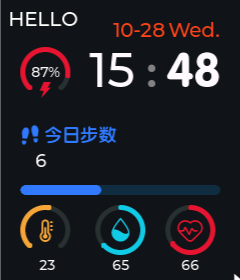
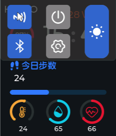

# 第 4 课：下拉面板与事件

> 状态：**已实现**。这一课第一次让界面"听懂"操作，也是第一次**往抽象层里写命令**。

## 效果

主页刚起来的时候面板是收着的，和上一课看到的一模一样：



在屏幕下半部分按住往下拖，面板滑出来：



这一张里 NFC 和蓝牙都点开过（蓝色 = 选中）。点蓝牙的瞬间控制台会打出：

```
[sim] BLE.Enable()   —— 真机上给 KT6328 上电使能
```

拖亮度条会打 `[sim] LCD.SetLight(58)`，点电源会打 `[sim] Power.Shutdown()`。
**控制台有字，就说明那条从界面到硬件抽象层的线通了。**

- 你的代码：[ui_HomePage.c](study_workstation/ovwatch_learn/User/GUI_App/Screens/Src/ui_HomePage.c)、
  [HWDataAccess.c](study_workstation/ovwatch_learn/User/Func/Src/HWDataAccess.c)
- 参考实现：[参考 ui_HomePage.c](Software/OV_Watch/User/GUI_App/Screens/Src/ui_HomePage.c) 543 行起

---

## 一、这一课多出来的两样东西

前三课的主页有个共同点：**没人碰它，它自己也在一格一格地变**。那是定时器。

这一课要的正好相反：**没人碰，它一点反应都不该有**。点蓝牙、拖亮度、往右滑——这些叫**事件**。

| | 定时器 `lv_timer` | 事件 `lv_event` |
|---|---|---|
| 什么时候发生 | 时间到了就发生 | 有人操作才发生 |
| 注册方式 | `lv_timer_create(回调, 500, NULL)` | `lv_obj_add_event_cb(控件, 回调, 事件类型, 数据)` |
| 回调参数 | 只有 `timer` | `e`：能问出"谁、什么事件、当前值" |

顺带还有第二件事：前三课界面只在**读**数据（`HWInterface.Power.power_remain`）。
这一课界面开始**下命令**（`HWInterface.BLE.Enable()`）——抽象层的另外半边。

---

## 二、事件怎么接：`lv_obj_add_event_cb`

[ui_HomePage.c:448](study_workstation/ovwatch_learn/User/GUI_App/Screens/Src/ui_HomePage.c#L448) 一口气接了六根线：

```c
lv_obj_add_event_cb(ui_HomePage,   ui_event_HomePage,   LV_EVENT_ALL, NULL);
lv_obj_add_event_cb(ui_NFCButton,  ui_event_NFCButton,  LV_EVENT_ALL, NULL);
lv_obj_add_event_cb(ui_BLEButton,  ui_event_BLEButton,  LV_EVENT_ALL, NULL);
lv_obj_add_event_cb(ui_PowerButton,ui_event_PowerButton,LV_EVENT_ALL, NULL);
lv_obj_add_event_cb(ui_SetButton,  ui_event_SetButton,  LV_EVENT_ALL, NULL);
lv_obj_add_event_cb(ui_LightSlider,ui_event_LightSlider,LV_EVENT_ALL, NULL);
```

四个参数从右往左看：

| 位置 | 写什么 | 说明 |
|------|--------|------|
| 3 | `LV_EVENT_ALL` | 这个控件的**所有**事件都报给我。只想收一种就写 `LV_EVENT_CLICKED` |
| 2 | 函数名 | 事件发生时调用它 |
| 1 | 控件 | 谁的事件 |

回调的写法是固定的：

```c
static void ui_event_BLEButton(lv_event_t *e)
{
    lv_obj_t *target = lv_event_get_target(e);      /* 谁触发的 */

    if (lv_event_get_code(e) != LV_EVENT_VALUE_CHANGED) {   /* 什么事件 */
        return;
    }
    ...
}
```

`LV_EVENT_ALL` 的代价是回调会收到几十种事件（按下、松开、焦点、绘制前……），
所以**第一行永远是按 `code` 分流**。参考工程用的是 `if (...) {...} if (...) {...}`，
我们写成 `if (code != 想要的) return;`，效果一样，少一层缩进。

常用的几个事件码：

| 事件 | 什么时候来 |
|------|-----------|
| `LV_EVENT_PRESSED` | 刚按下去 |
| `LV_EVENT_CLICKED` | 按下又松开，而且没拖走 |
| `LV_EVENT_VALUE_CHANGED` | 控件的"值"变了（可勾选按钮、滑块、开关） |
| `LV_EVENT_GESTURE` | 滑出了一段距离，构成手势 |
| `LV_EVENT_SCROLL` | 滚动容器动了（1.4 节的面板就靠它滚） |

---

## 三、按钮为什么能"点一下变蓝"

参考工程里 NFC 和蓝牙的按钮加了这一句：

```c
lv_obj_add_flag(ui_BLEButton, LV_OBJ_FLAG_CHECKABLE);
```

普通 `lv_btn` 是"按一下就弹回来"的。加上 `CHECKABLE` 之后它变成**开关**：
点一下进入 `LV_STATE_CHECKED`，再点一下退出来。

**这个状态是 LVGL 自己翻转的，你的代码不用管。** 回调只是被通知"翻了"，然后同步自己的变量：

```c
/* ui_HomePage.c:259 */
static void ui_event_BLEButton(lv_event_t *e)
{
    lv_obj_t *target = lv_event_get_target(e);

    if (lv_event_get_code(e) != LV_EVENT_VALUE_CHANGED) {
        return;
    }
    if (lv_obj_has_state(target, LV_STATE_CHECKED)) {
        HWInterface.BLE.Enable();
        ui_HomePageBLEEN = 1;
    } else {
        HWInterface.BLE.Disable();
        ui_HomePageBLEEN = 0;
    }
```

颜色也是"状态样式"自动切的，同样没写 if：

```c
lv_obj_set_style_bg_color(ui_BLEButton, lv_color_hex(0x808080), LV_PART_MAIN | LV_STATE_DEFAULT);
lv_obj_set_style_bg_color(ui_BLEButton, lv_color_hex(0x3264C8), LV_PART_MAIN | LV_STATE_CHECKED);
```

`LV_STATE_DEFAULT` 和 `LV_STATE_CHECKED` 是同一属性的两套值，LVGL 按控件当前状态挑一套来画。
**"按钮长什么样"和"按钮干了什么"就这样被分开了。**

> 那 `ui_HomePageBLEEN` 这个变量是干嘛的？它是给下一次进这个页面用的：
> 重建面板时 `if (ui_HomePageBLEEN) lv_obj_add_state(ui_BLEButton, LV_STATE_CHECKED);`，
> 把按钮恢复成上次的样子。等 2.1 课有了页面栈，这个细节就会真的用上。

---

## 四、亮度滑块

```c
/* ui_HomePage.c:294 */
static void ui_event_LightSlider(lv_event_t *e)
{
    if (lv_event_get_code(e) != LV_EVENT_VALUE_CHANGED) {
        return;
    }
    ui_LightSliderValue = (uint8_t)lv_slider_get_value(ui_LightSlider);
    HWInterface.LCD.SetLight(ui_LightSliderValue);
}
```

拖动过程中每一帧都会来一次 `VALUE_CHANGED`，所以背光是**跟着手指连续变**的，
不是松手才变。实机上这对应 PWM 占空比从 0 改到 100，背光会明显亮暗。

**一个要如实说明的地方**：参考工程把这个滑块做成 `50 × 110`，本意是竖着的亮度条。
但 LVGL 8.2 的 `lv_bar` **没有竖向模式**（`lv_bar_set_orientation` 是 9.x 才有的），
所以它实际是"一个很窄的横向条"——你在截图里看到的那条蓝色胶囊就是它。
我们保留了参考工程的尺寸和样式（行为一致、位置一致），只是**它长得不像竖条**，
这一点在实机上也一样。

---

## 五、下拉面板：一行动画都没写

这是本课最巧的地方。面板不是"点一下弹出来"的菜单，而是一个**比屏幕还长**的滚动容器。

```
   ┌──────────── 屏幕 280 高 ────────────┐
   │ 面板从 y=-10 开始，高 420           │
   │ ┌───────────────────────────────┐   │
   │ │ UpBGPanel 240×130（这行是面板） │   │
   │ │  NFC    电源        亮度 ▂▂    │   │
   │ │  BLE    设置                  │   │
   │ └───────────────────────────────┘   │
   │   …剩下 290 高是空的…               │  ← 给滚动的行程
   │ ┌───────────────────────────────┐   │
   │ │ DownBGPanel（透明，看不见）     │   │
   │ └───────────────────────────────┘   │
   └─────────────────────────────────────┘
```

三个要点：

1. **容器高 420，屏幕只有 280** → 内容超出可视区，LVGL 自动把它变成可滚动容器。
2. **底下那块 `DownBGPanel` 是透明的**，唯一作用是"把内容撑到 550"，
   让滚动有 130 px 的行程。没有它，容器里的东西不够长，滚不动。
3. **"收起"= 预先滚动 130**。创建完所有子控件后调一次
   [ui_HomePage.c:443](study_workstation/ovwatch_learn/User/GUI_App/Screens/Src/ui_HomePage.c#L443)：

```c
lv_obj_scroll_by(ui_DropDownPanel, 0, -130, LV_ANIM_OFF);   /* 内容整体上移 130 = 收起 */
```

之后**用户手指怎么动，就等价于调了一次 `lv_obj_scroll_by`**——LVGL 的输入层替你做了。
于是"往下拉出面板"根本不需要自己写动画、不需要算位置、不需要状态机，全靠滚动。

再补两个让它"手感对"的设置：

```c
lv_obj_clear_flag(ui_DropDownPanel, LV_OBJ_FLAG_SCROLL_ELASTIC | LV_OBJ_FLAG_SCROLL_CHAIN);
lv_obj_set_scroll_dir(ui_DropDownPanel, LV_DIR_VER);
```

- `SCROLL_ELASTIC`：关掉回弹，拖到头就停住，不会像橡皮筋一样甩。
- `SCROLL_CHAIN`：关掉"滚到头继续传给父控件"，免得把主页一起拖走。
- `LV_DIR_VER`：只认上下方向的拖动。左右滑留给手势（第七节）。

### 踩过的坑：`scroll_by` 必须放在最后

`lv_obj_scroll_by` 的实现是「把容器里**现有的**子控件整体挪一下」。
容器还是空的时候调用，没有东西可挪，这次位移就丢了。

我们把它写在 `HomePage_create_dropdown_panel()` 的**最后**，所以仿真里一启动面板是收起的。
参考工程把这句写在创建容器之后、放子控件之前（`ui_HomePage.c:549`）；
我们照那个顺序也试过一次，PC 上面板**一启动就是展开的**。
功能没坏，只是初始状态不同，差异见第八节。

---

## 六、第一次往抽象层里"写"

前三课界面只读：

```c
ui_BatArcValue = HWInterface.Power.power_remain;              /* 读数据字段 */
HWInterface.RealTimeClock.GetTimeDate(&DateTime);             /* 读函数 */
```

这一课开始发命令：

```c
HWInterface.BLE.Enable();                 /* 开蓝牙 */
HWInterface.BLE.Disable();                /* 关蓝牙 */
HWInterface.LCD.SetLight(ui_LightSliderValue);   /* 调背光 */
HWInterface.Power.Shutdown();             /* 关机 */
```

界面**依旧不知道背后是什么**。左边一列是界面写的，右边一列是抽象层决定执行的：

| 界面写 | `HW_USE_HARDWARE = 0`（PC） | `= 1`（实机） |
|--------|------------------------------|----------------|
| `BLE.Enable()` | 控制台打印 `[sim] BLE.Enable()` | `KT6328_Enable()`，给蓝牙芯片上电 |
| `LCD.SetLight(v)` | 打印 `[sim] LCD.SetLight(v)` | `LCD_Set_Light(v)`，改背光 PWM 占空比 |
| `Power.Shutdown()` | 打印 `[sim] Power.Shutdown()` | `Power_DisEnable()`，拉低电源芯片使能脚 |

对应的实现都在 [HWDataAccess.c](study_workstation/ovwatch_learn/User/Func/Src/HWDataAccess.c)：

```c
void HW_BLE_Enable(void)
{
#if HW_USE_BLE
    KT6328_Enable();
#else
    printf("[sim] BLE.Enable()   —— 真机上给 KT6328 上电使能\n");
#endif
}
```

**这就是函数指针的价值**：界面里那句 `HWInterface.BLE.Enable()` 一个字都不用改，
改一个宏，同样的代码就从"打印一行字"变成"真的给芯片上电"。

> 真机上关机是**立刻断电**，屏幕上什么都不会留下。所以仿真里我们只打印不退出——
> 程序退出了你就看不到后面的实验了。

---

## 七、右滑手势

面板占了整个屏幕，手势回调却注册在**屏幕** `ui_HomePage` 上：

```c
/* ui_HomePage.c:236 */
static void ui_event_HomePage(lv_event_t *e)
{
    if (lv_event_get_code(e) != LV_EVENT_GESTURE) {
        return;
    }
    if (lv_indev_get_gesture_dir(lv_indev_get_act()) == LV_DIR_RIGHT) {
        printf("[1.4] 收到右滑手势（参考实现跳菜单页，等 2.1 课有 PageManager 再接）\n");
    }
}
```

为什么注册在屏幕上也收得到？因为 LVGL 创建带父控件的对象时会默认加上
`LV_OBJ_FLAG_GESTURE_BUBBLE`：手势从被按下的对象开始，**一层层往父控件冒泡**，
直到某个对象没这个标志为止。面板 → 屏幕，正好冒到我们挂回调的那一层。

手势和滚动的分工：面板只接受竖直滚动（`LV_DIR_VER`），
所以横向拖动不会被它吃掉，才会变成 `LV_EVENT_GESTURE` 冒泡上来。

2.1 课做页面栈时，这一句会变成 `Page_Load(&Page_Menu)`。

---

## 八、和参考实现的差异

| 参考写法 | 我们的写法 | 原因 |
|----------|------------|------|
| `lv_obj_scroll_by(0,-130)` 写在放子控件之前 | 挪到所有子控件建好之后 | 否则位移丢失，面板一启动就是展开的 |
| 电源按钮 `Page_Load(&Page_Power)` | 打印 + `HWInterface.Power.Shutdown()` | 还没有页面栈，先演示"写抽象层" |
| 设置按钮 `Page_Load(&Page_Set)` | 打印 | 同上 |
| 右滑 `Page_Load(&Page_Menu)` | 打印 | 同上 |
| NFC 回调里 `ICcard_Select(1)`（参考里是注释掉的） | 只记状态 | 还原范围里没有 NFC 芯片 |
| 回调开头判断 `Page_Get_NowPage()->page_obj == &ui_HomePage` | 没有 | 只有一页，2.1 课补 |
| 图标字符用参考源码里的原始字节 | 写成 `"\xEE\xA6\x86"` 形式的宏 | 源码里那些字符看不见，宏至少能搜索 |

**没改的**：控件尺寸、位置、颜色、事件类型、回调用 `LV_EVENT_ALL` 再分流、
`CHECKABLE` 的用法、`scroll_dir` / 清 `SCROLL_ELASTIC` / 清 `SCROLL_CHAIN`，全部照抄。

这一课之后，表格里的差异已经记进 [对照表](对照表.md)，随时可以用
`study_workstation/tools/ref_diff.sh` 重新量一遍。

---

## 九、动手练习

1. **给 NFC 也加一句打印**。`ui_event_NFCButton` 里现在是静悄悄的改变量，
   加一行 `printf("[1.4] NFC %s\n", ...)`，确认它和蓝牙一样每次点都触发。
   （提示：`lv_obj_has_state(target, LV_STATE_CHECKED)` 的结果可以直接用。）
2. **让面板"点一下也能开"**。不用拖动：在屏幕回调里处理 `LV_EVENT_CLICKED`，
   调 `lv_obj_scroll_to_y(ui_DropDownPanel, 0, LV_ANIM_ON)` 看看——这是本课唯一
   需要"动画"的地方，LVGL 自己会补间。
3. **看看 130 和 150 的区别**。把初始滚动改成 `-150`，再收起面板，观察和 `-130` 有什么不同。
   （提示：容器有 10 px 内边距，滚动上限比你想的多 20 px。）
4. **长按关机**。把电源按钮的 `LV_EVENT_CLICKED` 改成 `LV_EVENT_LONG_PRESSED`，
   按住不放一秒才会关机——真手表基本都这么做，防止误触。

---

## 十、下一步

**单元 2.1：页面栈 `PageManager`。**

这一课里所有"本来该跳页"的地方我们都在打印。2.1 会把 `Page_t` 结构、
`Page_Load` / `Page_Back`、页面缓存和设备栈做出来，然后：

- 右滑 → 菜单页
- 设置按钮 → 设置页
- 电源按钮 → 滑动关机页

顺带要删掉临时的 `User/Func/Src/pubsub_stub.c`。

### 另一条路：硬件轨

想先摸真机就按 [硬件轨](硬件轨.md) 走：连 ST-Link、烧一遍参考固件。
之后每写通一个 BSP 驱动，就把 `HW_USE_HARDWARE` 往 `1` 挪一步——
这一课里那几个 `[sim]` 打印，会变成真的蓝牙上电、真的背光亮暗、真的关机。
