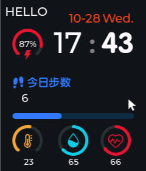
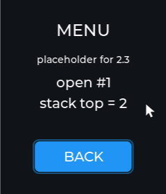
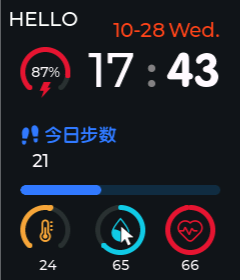
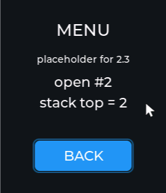

# 第 5 课：页面栈 PageManager

> 状态：**已实现**。这一课把前四课那一整块主页，变成"栈里的一页"。
> 从这节课开始，右滑不再是打印一行字，而是真的切屏幕。

## 效果

开机还是那个主页：



在屏幕上往右划一下，进菜单页：



点 `BACK` 回到主页：



再往右划一次，注意中间那行字：



`open #1` 变成了 `open #2`。这就是本课最重要的一句话：

> **页面不是"藏起来了"，是每次都重新建了一遍。**

- 你的代码：[PageManager.c](study_workstation/ovwatch_learn/User/Func/Src/PageManager.c)、
  [PageManager.h](study_workstation/ovwatch_learn/User/Func/Inc/PageManager.h)、
  [ui_MenuPage.c](study_workstation/ovwatch_learn/User/GUI_App/Screens/Src/ui_MenuPage.c)
- 参考实现：[参考 PageManager.c](Software/OV_Watch/User/Func/Src/PageManager.c)

---

## 一、为什么需要"栈"

前四课只有一页，屏幕由 `lv_disp_load_scr(ui_HomePage)` 一锤定音。
现在有第二页了，问题立刻出现：

- 从主页进菜单，**退回时怎么知道回哪**？
- 以后菜单再进设置、设置再进日期，**退三次要能原路退回来**。

答案就是"记路"：每进一页就往本子上添一笔，每退一页就划掉一笔。
后进先出——这就是**栈**。

```
        栈底                    栈顶
      [ Home ] --> [ Menu ] --> [ Set ]
                                    ^ 屏幕上显示这一页
```

主页永远在栈底，**退到栈底就不再退**。

---

## 二、`Page_t`：一页需要哪三样东西

[PageManager.h](study_workstation/ovwatch_learn/User/Func/Inc/PageManager.h)：

```c
typedef struct {
    void (*init)(void);      /* 建控件、建定时器 */
    void (*deinit)(void);    /* 停定时器、释放资源 */
    lv_obj_t **page_obj;     /* 指向"这一页的屏幕指针"的指针 */
} Page_t;
```

前两个是函数指针，不难理解：栈不关心菜单里画了什么，只负责在"进这一页"时
调用它的 `init`，在"离开这一页"时调用它的 `deinit`。

**第三个要多看一眼：`lv_obj_t **page_obj`，两个星号。**

### 为什么是"指针的指针"

页面自己的变量是这么定义的（[ui_MenuPage.c:24](study_workstation/ovwatch_learn/User/GUI_App/Screens/Src/ui_MenuPage.c#L24)）：

```c
lv_obj_t *ui_MenuPage = NULL;

Page_t Page_Menu = {ui_MenuPage_screen_init, ui_MenuPage_screen_deinit, &ui_MenuPage};
```

`ui_MenuPage` 是个**变量**，它的值会在 `init()` 里被重新赋值
（`ui_MenuPage = lv_obj_create(NULL);`），每次进页面都是新的地址。

如果 `Page_t` 里存的是 `lv_obj_t *`，那就在定义 `Page_Menu` 的那一刻把地址抄了下来——
那时候 `ui_MenuPage` 还是 `NULL`，抄到的是空。
存 `&ui_MenuPage`（变量的地址）才能每次都读到**最新**的值：

```c
lv_scr_load_anim(*newPage->page_obj, ...);   /* 解引用一次，拿到当前屏幕 */
```

一句话：**结构体里存"变量的地址"，用的时候再取值。**

---

## 三、栈的本体

```c
#define MAX_DEPTH 6

typedef struct {
    Page_t *pages[MAX_DEPTH];   /* 存的是 Page_t 的指针，不是副本 */
    uint8_t top;                /* 下一个空位的下标，同时也就是"现在有几页" */
} PageStack_t;

extern PageStack_t PageStack;
```

`top` 的含义值得记住，两种读法都对：

- `top == 0`：空栈
- `top == 2`：栈里有 2 页，栈顶是 `pages[top - 1]` 即 `pages[1]`

所以菜单页上那行 `stack top = 2`，意思是**当前栈里有主页、菜单两页**。

### 四个内部操作

[PageManager.c:26-63](study_workstation/ovwatch_learn/User/Func/Src/PageManager.c#L26-L63)，
全部是 `static`——外面只能通过 `Page_Load` / `Page_Back` 用它们，栈不会被谁随手改坏：

| 函数 | 干什么 | 细节 |
|------|--------|------|
| `page_stack_init` | `top = 0` | 开机清空 |
| `page_stack_push` | 写进 `pages[top]`，`top++` | 满了返回 `-1` |
| `page_stack_pop` | `top--`，然后对弹出的页调 `deinit()` | **先减再删** |
| `get_top_page` | `pages[top - 1]`，空栈返回 `NULL` | `Page_Get_NowPage` 就是它 |

`pop` 里的 `stack->pages[--stack->top]->deinit();` 一行干了三件事：
把 `top` 减一、取到被弹掉的那一页、让它自己清理干净。
定时器不在这里删，就永远没人删了——**谁建的谁拆，拆的时机由栈来叫**。

---

## 四、`Page_Load`：进新页的四步

[PageManager.c:124](study_workstation/ovwatch_learn/User/Func/Src/PageManager.c#L124)：

```c
void Page_Load(Page_t *newPage)
{
    if (PageStack.top >= MAX_DEPTH - 1) return;      /* ① 满了就不进 */

    if (PageStack.top > 0) {
        PageStack.pages[PageStack.top - 1]->deinit(); /* ② 先把当前页收拾干净 */
    }

    page_stack_push(&PageStack, newPage);             /* ③ 新页入栈 */
    newPage->init();                                  /* ④ 新建屏幕和控件 */
    lv_scr_load_anim(*newPage->page_obj,
                     LV_SCR_LOAD_ANIM_MOVE_RIGHT, 100, 0, true);
}
```

顺序不能换：**先 deinit 旧的，再 init 新的**。
如果反过来，两个页面的定时器会同时活着，旧页的定时器还会去改已经被删掉的控件。

### 最后一个 `true` 是整节课的坑

```c
lv_scr_load_anim(screen, anim, time, delay, auto_del);
```

`auto_del = true` 的意思是：**动画播完，把旧屏幕删掉。**

LVGL 默认不会帮你留旧屏幕。所以：

- 旧屏幕上的控件在 `100ms` 后全部消失，指针变成野指针
- 想回到那一页，只能**重新 `init()` 一遍**

这就是 `open #2` 的来历。它不是一个"计数"，它是**证据**：
页面真的被销毁又重建了。

> 如果哪天你想要"切回去还在原地"（比如菜单滚动位置），就得自己在
> `deinit` 里把状态存下来、`init` 时再恢复。参考工程的实现是
> `ui_MenuScrollY = 0;`——每次回来都从头开始，见
> [参考 ui_HomePage.c](Software/OV_Watch/User/GUI_App/Screens/Src/ui_HomePage.c) 第 271 行。

---

## 五、退回去：`Page_Back` 与 `Page_Back_Bottom`

```c
void Page_Back(void)
{
    if (page_stack_is_empty(&PageStack)) return;

    page_stack_pop(&PageStack);        /* 当前页出栈 + deinit */

    if (page_stack_is_empty(&PageStack)) {
        /* 理论上走不到：主页永远不会被弹出 */
        page_stack_push(&PageStack, &Page_Home);
        page_stack_push(&PageStack, &Page_Menu);
        Page_Menu.init();
        ...
    } else {
        Page_t *previous_page = PageStack.pages[PageStack.top - 1];
        previous_page->init();         /* 上一页也早被删了，得重建 */
        lv_scr_load_anim(*previous_page->page_obj,
                         LV_SCR_LOAD_ANIM_MOVE_RIGHT, 100, 0, true);
    }
}
```

三个要点：

1. **退回去也要 `init()`**。上一页在当初被 `auto_del` 删掉了，现在等于从头建。
2. 栈空的那个分支是**兜底**，正常流程永远走不到（主页在栈底，`pop` 到它就停）。
   参考实现照样写了，我们也照抄——读别人的代码时，"看起来不可能"的分支
   往往就是出错时救命的那个。
3. 动画方向仍是 `MOVE_RIGHT`。真机上两条路径看起来不一样（进入/返回），
   这点等 2.5 做动画时再统一。

`Page_Back_Bottom` 是"一键回主页"：`while (top > 1) pop;`，把中间页全弹掉。
菜单页里"设置""关于"这类入口以后会用到它。

---

## 六、`ui_init` 变了

前四课（[ui.c](study_workstation/ovwatch_learn/User/GUI_App/ui.c)）：

```c
ui_HomePage_screen_init();
lv_disp_load_scr(ui_HomePage);
```

这一课：

```c
Pages_init();                                   /* 建栈、压主页、显示主页 */
lv_timer_create(main_timer, 1000, NULL);        /* 主定时器，现在是空的 */
```

`Pages_init()` 里干的事：

```c
page_stack_init(&PageStack);
page_stack_push(&PageStack, &Page_Home);
Page_Home.init();
lv_disp_load_scr(*Page_Home.page_obj);
```

**从此"显示哪一页"不再写死在 `ui_init` 里**，而是由栈决定。
再加十个页面，`ui.c` 一行都不用改——这就是把导航抽出来的好处。

`main_timer` 现在是空函数，参考工程里也是空的。它留着是给阶段 6 的任务层挂着用的，
先建出来，免得以后忘了"还有这么个 1 秒的心跳"。

---

## 七、主页那根线：右滑 → `Page_Load`

[ui_HomePage.c:247](study_workstation/ovwatch_learn/User/GUI_App/Screens/Src/ui_HomePage.c#L247)：

```c
static void ui_event_HomePage(lv_event_t *e)
{
    if (lv_event_get_code(e) != LV_EVENT_GESTURE) return;

    if (lv_indev_get_gesture_dir(lv_indev_get_act()) == LV_DIR_RIGHT) {
        Page_Load(&Page_Menu);
    }
}
```

第 4 课这里打印了一行 `[sim]` 就完了，现在真的跳页。

**为什么是"屏幕"收到手势，而不是某个按钮？**
LVGL 的手势发给你**按下的那个控件**，只要那些控件带 `LV_OBJ_FLAG_GESTURE_BUBBLE`，
事件就一路冒泡到最外层——也就是屏幕。主页上绝大多数控件都带这个标志，
所以随便从哪划都行；屏幕本身没有这个标志，冒泡到它就停下。

### 手势不触发时，先看这两条

这是本课调试时真踩到的坑，记下来省你以后的时间：

1. **有东西在滚动就不会有手势。** LVGL 里 `scroll_obj != NULL` 时直接返回，
   拖拽被当成滚动吃掉了。
2. **每次采样的位移都要够大。** LVGL 的 `indev_gesture()` 是这样累计的：

   ```c
   if (|vect.x| < gesture_min_velocity && |vect.y| < gesture_min_velocity)
       gesture_sum.x = gesture_sum.y = 0;   /* 这一帧没动 → 前面的全作废 */
   gesture_sum += vect;
   ```

   手指连续滑动没问题；但用程序模拟时，如果"动一下、停一下"，
   每一帧停滞都会把累计值清零，永远凑不满 50 像素的 `gesture_limit`。
   真机上不会这样，模拟器上很容易踩到。

---

## 八、菜单页为什么是英文

菜单页现在是个占位版本，等 2.3 课换成真菜单。它上面写的是 `MENU` / `open #1` / `BACK`
而不是中文——不是为了好看，是被字体逼的。

`GUI_App/Fonts/` 里的 `Cuyuan18`、`Cuyuan30` 这些字体，都是 SquareLine **按页裁剪**出来的子集：

```
Cuyuan18 的源字符集：改写选择开发中今日步数
Cuyuan30 的源字符集：0123456789C%
```

它们只包含**那一页用得到的那几个字**。你写"菜单"两个字，字库里没有，
LVGL 只会打一条警告，然后画一片空白：

```
lv_draw_sw_letter: lv_draw_letter: glyph dsc. not found for U+83DC
```

**结论**：这个工程里加中文，必须重新导字体（SquareLine Studio 或 `lv_font_conv`）。
这条规矩从 2.3 课做真菜单起就绕不开了——到时候我们一起导一份 `ui_font_Menu`。

---

## 九、参考实现里的两个小怪癖

代码是照抄参考的，所以怪癖也一起抄来了。知道它们存在，以后读别人的代码才不会被骗：

| 位置 | 现象 | 解释 |
|------|------|------|
| `page_stack_push/pop` | 返回类型是 `uint8_t`，失败却 `return -1;` | 实际返回 `255`。调用方没检查返回值，所以一直没暴露 |
| `Page_Load` | 判满是 `top >= MAX_DEPTH - 1` | 比真正的满（`top >= MAX_DEPTH`）早一格。**6 层的栈实际只能用 5 层** |

这两个都不是我们改的——**还原阶段跟着参考走**，等哪天要修，单独提一次，
在[对照表](对照表.md)里记一笔。

---

## 十、怎么自己验证

菜单页上那两个数字就是量尺：

- `open #N`：`static uint32_t menu_open_count`，每次 `init` 加一。
  从 1 变 2，说明 **`init` 真的又被调了一次**。
- `stack top = 2`：栈里确实有两页。

自己动手改几处，再看数字怎么变：

1. 在 `Page_Back` 里把 `previous_page->init()` 删掉 → 回来时黑屏（旧屏幕早被删了）。
2. 在 `ui_MenuPage_screen_deinit` 里加一行 `printf("menu deinit\n")` → 看它什么时候被调用。
3. 在主页也加个 `home_open_count` → 发现回主页时它也在涨，证明主页同样被重建。

> **不想用鼠标自己滑？** 这节课的截图是用脚本滑出来的：
> `study_workstation/tools/simui.ps1`（`Start-Sim` / `Drag-Sim` / `Click-Sim` / `Capture-Sim`）。
> 里面记着三个坑：光标瞬移不产生 motion 事件、相对移动会被指针加速放大、
> LVGL 手势每帧没位移就清零——以后要自动验证别的页面，直接 dot-source 它。

---

## 十一、和参考工程对一对

跑一次 `study_workstation/tools/ref_diff.sh`（只看这几行）：

```
[~]  Func/Src/PageManager.c      参考 135 行   我们 146 行   重合 67%   接口 0 缺 / 0 多
[~]  Func/Inc/PageManager.h      参考  33 行   我们  44 行   重合 90%   接口 0 缺 / 0 多
[~]  GUI_App/ui.c                参考  38 行   我们  31 行   重合 40%   接口 0 缺 / 0 多
```

- **接口 0 缺 0 多**：六个函数一个不少，这是最要紧的。
- `PageManager.c` 重合 67%：差的都是注释和空行（参考写得很省注释，我们写得多）。
- `ui.c` 重合 40%：参考里有两段 `#error` 的颜色深度检查、还有 `lv_conf` 相关的守卫，我们没有搬。

`ui_MenuPage.c` 现在重合只有 1%，那是**意料之中**的：参考的菜单页有 820 行，
真正的滚动列表、11 个面板事件都在 2.3 课，我们现在是 80 行的占位。

---

## 十二、练习

1. **加一句"直接回主页"**：在菜单页放第二个按钮，调 `Page_Back_Bottom()`。
   现在栈里只有两页，看不出区别——**等 2.3 做完菜单、能再进设置页时**，
   它一下就能把中间页全弹掉。
2. **把 `MAX_DEPTH` 改成 2**，然后反复进出菜单，看 `Page_Load` 什么时候拒绝入栈。
   （改完记得改回来。）
3. **给主页的 `deinit` 加日志**，确认它在 `Page_Load(&Page_Menu)` 里被调用，
   而不是在屏幕切换之后。

下一单元：**2.2 发布/订阅事件总线**。页面栈负责"在哪一页"，
`pubsub` 负责"数据变了通知谁"——做完这两个，后面的页面才不用互相 `#include`。
